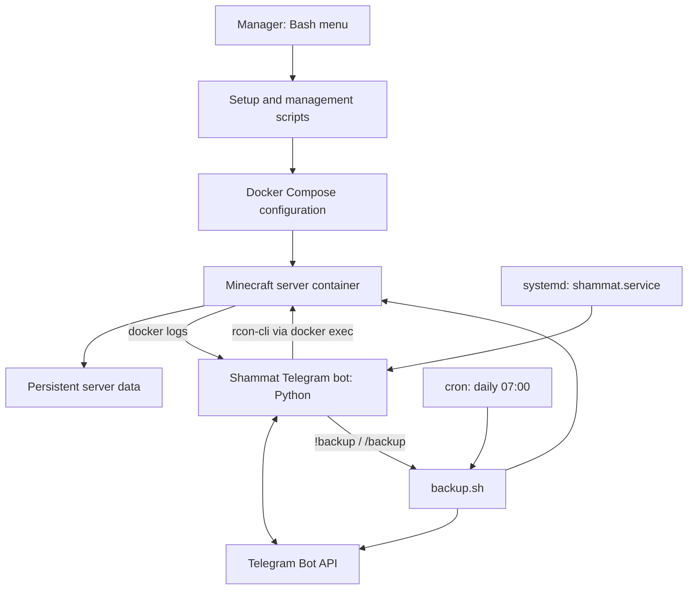
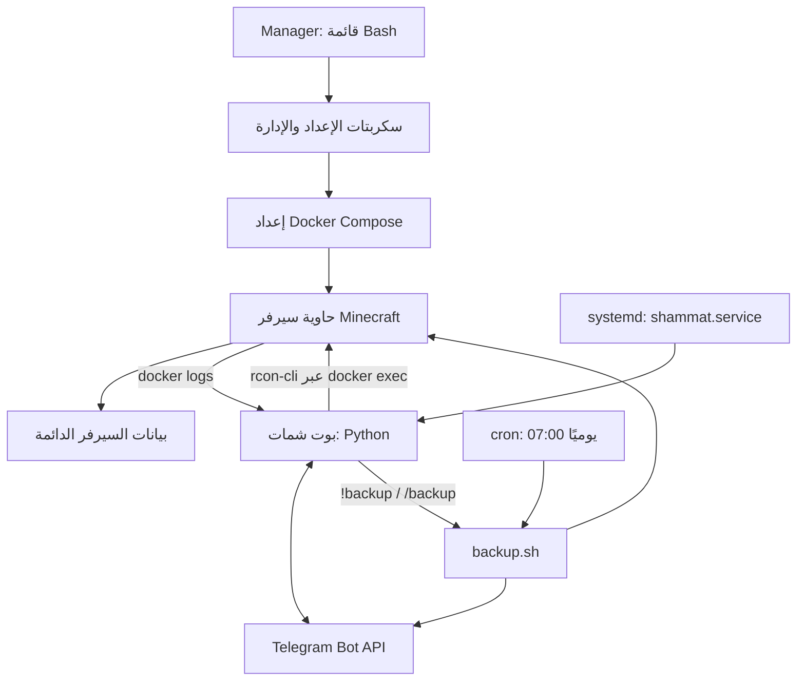

# Shammat | شمات

**One manager. One VPS. A Docker-powered Minecraft server and an optional Telegram companion bot.**

Shammat is a small server-management project designed to make setting up and managing a Minecraft server less intimidating. Instead of remembering a long list of commands, connect to your VPS, run a single installation command, then type `shammat` to open the interactive **Manager** and choose what you want to do.

**Languages:** [English](#english) · [العربية](#العربية)

- Install and manage a Minecraft server from a menu.
- Choose a Minecraft version and server type: Fabric, Forge, NeoForge, Paper, or Vanilla.
- Start, stop, restart, and inspect server logs, or send commands from an interactive console.
- Create, schedule (daily), and restore server backups, with automatic upload to Telegram.
- Optionally install the Shammat Telegram bot: death reactions, roasts, player stats, and a two-way chat bridge.
- Arabic and English bot messages, with support for adding more languages.

> **Important:** Shammat's Manager is a shell script intended for an Ubuntu-based Linux VPS and requires root privileges. It installs/configures software and writes files under `/root`. Review scripts before running them on a production server, and take backups before restoring or reconfiguring a server.

* * *

# English

## Why is it called “Shammat”?

**Shammat** (شمات) takes its name from the Arabic word **الشماتة** — gloating or teasing someone after a mishap. The project's original idea was a Minecraft companion that reacts when players die, with playful, sarcastic messages. The project also includes a Manager that helps you set up and control the Minecraft server itself.

## 1. What is the Manager?

The **Manager** is the control panel for the project. You run it in your VPS terminal and select actions from a simple numbered menu.

It can help you:

- Install a Minecraft server and choose its version and server type.
- Start, stop, restart, and view server logs.
- Open an interactive console to send Minecraft commands (through RCON).
- Create backups and restore a previous backup.
- Install, restart, reconfigure, or remove the Shammat Telegram bot.
- Manage the Minecraft usernames allowed to request an in-game backup.

You do not need to run each management script manually: just type `shammat` and use its menu.

## 2. Before you start

You need:

- A Linux VPS running an Ubuntu-based distribution.
- SSH access and root privileges (or an account allowed to use `sudo`).
- Enough RAM and disk space for your chosen Minecraft version, players, mods, and world. Backups need extra disk space (see [Backups](#backups-and-restore)).
- Access to your VPS provider's firewall/security-group settings so you can allow the Minecraft port.
- `curl`, `git`, and `python3`. The installer is downloaded with `curl` and fetches the project with `git`; it does not install either of them for you. The Manager and the Telegram bot both run on Python 3, so install it too. If any of them is missing, install them first:

```
sudo apt update
sudo apt install -y curl git python3
python3 --version
```

The included Docker setup script uses Docker's Ubuntu APT repository. Other distributions may require adapting that script.

### Do you need to be root?

Both the installer and the Manager require root privileges. You do not have to switch to a root shell: if your account has `sudo` permission, just put `sudo` in front of the commands below. (If you prefer a root shell, run `sudo -i` once; `whoami` should then print `root` and you can drop `sudo`.)

If `sudo` says you are not allowed to use it, you cannot grant yourself root access with a command. Sign in using the VPS provider's root account/console, or ask the server administrator to grant the required access. Do not share your root password or SSH private key.

## 3. Install Shammat with one command

Run this single command on your VPS:

```
sudo curl -sSL https://raw.githubusercontent.com/wissam-al-kahwaji/shammat/main/install.sh | sudo bash
```

The installer will:

1. Create `/root/shammat` and download the official Shammat repository (`https://github.com/wissam-al-kahwaji/shammat`) into it.
2. Make `manager.sh` executable.
3. Create a global `shammat` command at `/usr/local/bin/shammat`, so you can launch the Manager from any directory.

When it finishes it prints `Installation completed successfully!`. To confirm the command exists:

```
command -v shammat
```

It should print `/usr/local/bin/shammat`.

**The install location still matters.** Shammat's scripts expect the project at `/root/shammat`. You do not need to `cd` there yourself: the `shammat` command does that for you before starting the Manager.

> **Review before you run:** this command downloads a script from the internet and runs it as root. To read it first, open `https://raw.githubusercontent.com/wissam-al-kahwaji/shammat/main/install.sh` in your browser or run `curl -sSL https://raw.githubusercontent.com/wissam-al-kahwaji/shammat/main/install.sh`.

> **Already installed?** The installer removes the existing files inside `/root/shammat` before downloading a fresh copy. If that folder contains configuration, bot credentials, statistics, or backups, inspect it and back it up before running the command again.

## 4. Start the Manager

Once installation is complete, simply type:

```
shammat
```

If you are not logged in as root, use `sudo shammat`. You can run it from any directory; it is equivalent to running `cd /root/shammat && ./manager.sh`.

The Manager shows the current state of the server and the bot, then displays its main menu. Type the number for the action you want. Type `exit` at the main menu to close the Manager.

| Option | Menu entry                            | What it does                                                                                              |
|--------|---------------------------------------|-----------------------------------------------------------------------------------------------------------|
| `1`    | Server Status & Power Control         | Start, stop, or restart the server and view logs. Offers installation if the server is not installed yet. |
| `2`    | Interactive In-Game Console (rcon)    | Send Minecraft commands to the running server. Type `exit` or `quit` to leave.                            |
| `3`    | Backup Manager & Server Restore       | Take a manual backup or restore a previous one.                                                           |
| `4`    | Shammat Telegram Bot Manager          | Install, restart, reconfigure, or remove the Telegram bot.                                                |
| `5`    | Setup & Installation Center          | Install/re-configure the Minecraft server and install/remove the bot.                                     |
| `6`    | Manage In-Game Backup Admins (!backup) | Choose which players may run `!backup` in game.                                                           |

The menus adapt to what is installed. For example, option `1` offers *Start* when the server is stopped and *Stop/Restart* when it is running.

## 5. Install your Minecraft server

From the Manager:

1. Choose **5 — Setup & Installation Center**.
2. Choose **1 — Install Minecraft Server**. (If the server is already installed, this option re-configures and **overwrites** it.)
3. Shammat first runs `setup_docker.sh` to install Docker, then asks you the following questions:
   1. **Minecraft version** — required, for example `1.21` or `1.20.1`. Only numbers and dots are accepted.
   2. **Server type** (press Enter for the default, Vanilla):
      - **Vanilla** — the standard server without a mod/plugin platform.
      - **Fabric** — commonly used for Fabric mods and performance mods.
      - **Forge** — traditional modded servers.
      - **NeoForge** — a modern fork of Forge.
      - **Paper** — a performance-focused server that supports plugins.
   3. **Cracked (non-premium) server?** — answer `y` or `n`. Answering `y` disables online-mode authentication. **Only choose this if you understand the security risks.** Offline mode can allow impersonation of usernames unless access is otherwise protected.
   4. **Server name / MOTD** (default: `My Minecraft Server`).
   5. **World name** (default: `world`) and an optional **world seed** (leave empty for a random seed).
   6. **RAM allocation** — required; a number followed by an **uppercase** `G`, for example `2G`, `4G`, `8G`.
   7. **Max players** (default: `20`).
4. Let the setup finish. Shammat creates the Docker Compose configuration under `/root/minecraft` and starts the server container.

The server port is fixed at **8080**. If `ufw` is installed, the setup script opens `8080/tcp` in it automatically. You must still allow TCP port `8080` in your VPS provider's firewall/security group. Players connect using `YOUR_VPS_IP:8080`. Do not assume the default Minecraft port `25565` is configured.

### Docker image and service architecture

Shammat does not build a custom Minecraft server image. The setup script generates a Docker Compose configuration that runs the upstream [`itzg/minecraft-server`](https://github.com/itzg/docker-minecraft-server) image.

The generated configuration sets the selected Minecraft version and server type, the memory, MOTD, world name, seed, online-mode, and max players, maps the game port, and mounts the server data directory. The container is named `minecraft-server`, which is also the name used by the Telegram bot integration.

Key details:

- **Container image:** `itzg/minecraft-server:latest` (as configured by the current setup script).
- **Container management:** Docker Compose, in `/root/minecraft`.
- **Persistent data:** the host-side `./data` directory (`/root/minecraft/data`) is mounted at `/data` inside the container.
- **Container name:** `minecraft-server`.
- **Configured game port:** TCP `8080`.
- **Restart policy:** `unless-stopped`.
- **EULA:** the generated configuration sets `EULA: "TRUE"`, so by using the setup script you accept the [Minecraft EULA](https://www.minecraft.net/en-us/eula).

> **Versioning note:** The `latest` image tag can change over time. For a more reproducible deployment, consider pinning a tested image version and documenting how to update it.

### Architecture overview



The Manager configures and controls the Minecraft server and the optional Telegram bot. Minecraft runs in its own Docker container, while the Python bot is managed separately by `systemd`. The bot follows the container's logs to react to game events, and talks back to the game through `rcon-cli` inside the container.

### Technology stack and external dependencies

| Component               | Technology                           | Role                                                       |
|-------------------------|--------------------------------------|------------------------------------------------------------|
| Management interface    | Bash                                 | Interactive setup and administration                       |
| Minecraft runtime       | `itzg/minecraft-server` Docker image | Runs the selected Minecraft server distribution            |
| Container orchestration | Docker Engine and Docker Compose     | Creates and manages the Minecraft container                |
| Telegram companion      | Python 3 (standard library only)     | Processes game events and Telegram commands                |
| Bot process management  | systemd                              | Starts and supervises `shammat.service`                    |
| Scheduled backups       | cron + `7z` (p7zip)                  | Daily backup at 07:00, split into Telegram-sized archives  |
| Game data               | Host directory mounted at `/data`    | Persists the world and server files outside the container  |
| Messaging integration   | Telegram Bot API                     | Delivers notifications and receives bot commands           |

The Minecraft image is maintained by the upstream `itzg/docker-minecraft-server` project and is an external dependency of Shammat. Shammat provides the management scripts and configuration that connect these components; it does not claim to develop or maintain the Minecraft server software itself.

### Server controls

Open the Manager again and choose **1 — Server Status & Power Control**. Depending on the server state, the menu offers:

- **When running:** view live logs (press `Ctrl+C` to return), stop the server, or restart it.
- **When stopped:** start the server or view the last 100 log lines.

Choose **2 — Interactive In-Game Console** from the main menu to send Minecraft commands while the container is running. Type `exit` or `quit` to leave that console.

### Backups and restore

Shammat's backup script (`backup.sh`) works like this:

1. It sends a Telegram notice (**scheduled** mode waits **15 minutes** after warning; **emergency** mode, started with `--now`, skips the warning and starts immediately).
2. It stops the Minecraft container (allowing up to 120 seconds for the world to save), copies a snapshot of `/root/minecraft`, and **starts the server again right away**. Only this short window counts as server downtime.
3. It compresses the snapshot into a **multi-volume 7z archive** (45 MB parts) under `/root/backups/minecraft_<date>/`.
4. It keeps the **5 most recent** backups and deletes older ones.
5. It uploads every part to your Telegram chat and sends a final report (size, parts, downtime, total time, free disk space). If anything fails, the server is restarted and a failure notice is sent.

Ways to run a backup:

| How                                             | Mode                         |
|-------------------------------------------------|------------------------------|
| **Daily at 07:00** (cron job added by the bot setup) | Scheduled, 15-minute warning |
| **Manager → 3 → 1** (manual backup)             | Emergency, starts immediately |
| **`!backup` in game** (see below)               | Emergency, after a 60-second in-game countdown |
| **`/backup` in Telegram** (admins only)         | Emergency, after the same countdown |

**Requirements:** backups use `7z` (`apt install -y p7zip-full`) and read the Telegram credentials from `/root/shammat/.telegram.env`, so **install and configure the Telegram bot first**. Make sure the disk has room for the server folder, a temporary snapshot, and the compressed copies.

**Restoring:** choose **3 — Backup Manager & Server Restore → 2**, pick a backup, and confirm. The Manager stops the server, **deletes `/root/minecraft`**, extracts the selected archive, and starts the server again. Restoring overwrites the current server data, so confirm you selected the correct backup and keep a separate copy of anything important.

## 6. Install the Shammat Telegram bot (optional)

The bot is optional. You can run and manage the Minecraft server without installing it. (Backups, however, need the bot's Telegram credentials.)

### What does the bot do?

Shammat follows the Minecraft server log and reacts to game events. Depending on the event and selected language, it can:

- Send playful gloating messages when players die. Deaths are classified (void, lava, drowning, explosion, fire, starvation, falling, PvP, mobs, or generic) so each type gets suitable reactions, and each player's death count is tracked.
- React to players joining or leaving, to advancements, and when the server becomes ready or empties.
- Post occasional **ambient messages** at random intervals (from a few minutes to about an hour), with a different tone when nobody is online or late at night.
- Provide online-player, server-status (including uptime), and death-leaderboard information.
- Send a roast/teasing message aimed at a random online player.
- Bridge chat: send Telegram messages into the game (`/say`) and game messages to Telegram (`!tg`).
- Request, count down, and cancel backups, and show information about the latest backup.
- Skip Telegram notifications for joins, leaves, deaths, and advancements when all known players are already online in the game.
- Ignore **fake players (bots)**, such as a bot parked at a mob farm or chunk loader, using rules you control in `fake_players.json` (see [Fake players](#fake-players-bots)).

### Prepare Telegram

1. Create a Telegram bot using Telegram's official **@BotFather** and copy its bot token.
2. Determine the Telegram chat ID where Shammat should send messages. Add the bot to the intended chat if necessary and ensure it has permission to send messages.
3. Keep the token private. Anyone who obtains it may be able to control your bot.

### Install from the Manager

1. Run `shammat`.
2. Choose **4 — Shammat Telegram Bot Manager**, or **5 — Setup & Installation Center**.
3. Choose the option to install/configure the bot.
4. Pick the language from the numbered list. The list is built from the folders inside `language/` (currently `ar` for Arabic and `en` for English). The selected `responses.json` and `texts.json` are copied into `/root/shammat`, replacing the previous ones.
5. Enter the Telegram **bot token** and **chat ID** when requested.
6. The setup script saves the credentials to `.telegram.env`, installs and starts the `shammat.service` systemd service, and adds the **daily 07:00 backup** to root's crontab.

The bot expects the Minecraft container to be named `minecraft-server` and the server data at `/root/minecraft/data`, matching the included server setup.

### Optional settings in `.telegram.env`

The setup script writes only `BOT_TOKEN` and `CHAT_ID`. You can add these optional lines by hand, then restart the bot from the Manager:

```
BOT_TOKEN="123456:ABC..."
CHAT_ID="-1001234567890"
GROUP_CHAT_ID="-1009876543210"   # optional second chat that may also use the bot
TG_ADMIN_IDS="11111111,22222222" # Telegram user IDs allowed to use /backup and /cancel
```

Without `TG_ADMIN_IDS`, nobody can run `/backup` or `/cancel` from a regular chat (posts made as a channel in the main chat count as admin). In-game `!backup` is controlled separately (see below).

### Bot controls and logs

Use **4 — Shammat Telegram Bot Manager** in the Manager to restart, reconfigure (this re-runs the setup, including language selection), or remove the bot service.

To inspect its service status and logs directly:

```
systemctl status shammat --no-pager
journalctl -u shammat -n 100 --no-pager
```

To follow logs live:

```
journalctl -u shammat -f
```

The bot configuration is stored in `/root/shammat/.telegram.env`. Do not publish or share this file; it contains credentials.

### Telegram commands

The bot supports these commands in its configured chat:

- `/start`, `/menu`, or `/help` — open the bot menu with quick buttons.
- `/online` — show online players.
- `/status` — show server status, uptime, and player count.
- `/deaths` — show the death leaderboard.
- `/roast` — request a teasing message.
- `/lastbackup` — show information about the latest backup.
- `/say message` — send a message to the Minecraft server.
- `/backup` — request a backup (admins only).
- `/cancel` — cancel a pending backup countdown (admins only).

### In-game commands

Type these in the Minecraft chat:

| Command         | What it does                                                          |
|-----------------|-----------------------------------------------------------------------|
| `!help`         | Show the list of commands.                                            |
| `!online`       | Show how many players are online.                                     |
| `!deaths`       | Show the top players by deaths.                                       |
| `!roast`        | Roast another random online player (also sent to Telegram).           |
| `!tg message`   | Send a message to the Telegram chat.                                  |
| `!backup`       | Start a backup after a 60-second countdown (if players are online).   |
| `!cancel`       | Cancel a backup during its countdown.                                 |

**Who may run `!backup`?** Open the Manager and choose **6 — Manage In-Game Backup Admins** to add or remove Minecraft usernames (stored in `backup_players.json`). **If the list is empty, everyone can run `!backup`.** The bot reloads the file automatically. Because Minecraft usernames can be spoofed on an offline/cracked server, do not rely on this list as a strong security boundary there.

### Customizing messages and adding a language

All bot texts live in `texts.json`, and all reaction lines (death, join, roast, ambient, and so on) live in `responses.json`; both are copied from the language you selected. Edit them in `/root/shammat` to change wording. `texts.json` is reloaded when it changes, so most edits do not need a restart. Re-running the bot setup replaces both files with the language's defaults, so keep a copy of your changes.

To add a new language, create `language/<code>/` containing its own `responses.json` and `texts.json` (use `en` as a template). It will appear in the language list the next time you run the bot setup.

### Fake players (bots)

Many servers keep fake players (bots) in the world, for example at a mob farm or a chunk loader. You can tell Shammat to ignore them: a name that matches a rule is **not treated as a player**, so the bot does not react to it, does not count it, and does not keep data about it.

The rules live in `/root/shammat/fake_players.json`. The bot creates this file on first start with empty lists, so **nothing is treated as fake until you add rules.** Example:

```
{
  "names": ["botmobtrap"],
  "prefixes": ["fakeplayer", "bot_"],
  "suffixes": ["_afk"],
  "patterns": ["^chunk.*\\d+$"]
}
```

A name is fake if it matches **any** rule (case-insensitive):

| Key        | Matches                                                                                       |
|------------|-----------------------------------------------------------------------------------------------|
| `names`    | The exact player name.                                                                        |
| `prefixes` | Names that start with the text.                                                               |
| `suffixes` | Names that end with the text.                                                                 |
| `patterns` | Regular expressions. In JSON, write each backslash twice (for example `\\d` for a digit).      |

Good to know:

- **No restart needed.** The bot re-reads the file within about 5 seconds of an edit.
- **A mistake will not break the bot.** If the file is not valid JSON, the previous rules stay active. An invalid regular expression is skipped and reported in the logs.
- A single string is accepted instead of a list (`"names": "botmobtrap"`).
- Check `journalctl -u shammat -n 50 --no-pager` for lines starting with `[fake-players]`; they show how many rules were loaded.

## 7. Project files

| File                                                | Purpose                                                          |
|-----------------------------------------------------|------------------------------------------------------------------|
| `install.sh`                                        | One-command installer; creates the `shammat` command.           |
| `manager.sh`                                        | The interactive Manager (control panel).                         |
| `setup_docker.sh`                                   | Installs Docker (Ubuntu APT repository).                         |
| `setup_server.sh`                                   | Asks the setup questions and creates/starts the server.          |
| `command.sh`                                        | Interactive in-game (RCON) console.                              |
| `backup.sh`                                         | Backup script (snapshot, 7z volumes, Telegram upload, rotation). |
| `setup_bot.sh`, `restart_bot.sh`, `remove_bot.sh`   | Install, restart, and remove the bot service.                    |
| `shammat.py`, `shammat.service`                     | The Telegram bot and its systemd unit.                           |
| `backup_players.json`                               | Players allowed to run `!backup` in game.                        |
| `fake_players.json`                                  | Fake-player (bot) rules; created by the bot on first start.      |
| `language/<code>/`                                  | Bot messages (`texts.json`, `responses.json`) for each language. |

## 8. Useful paths

| Path                          | Purpose                                                         |
|-------------------------------|-----------------------------------------------------------------|
| `/root/shammat`               | Shammat source, scripts, language files, and bot configuration  |
| `/root/shammat/.telegram.env` | Telegram credentials — keep private                             |
| `/root/shammat/texts.json`, `responses.json` | Active bot messages for the selected language    |
| `/root/shammat/stats.json`, `state.json`     | Death statistics and the bot's saved state       |
| `/root/shammat/backup_players.json`          | Players allowed to run `!backup`                 |
| `/root/shammat/fake_players.json`            | Rules that mark players as fake (bots) to ignore  |
| `/root/minecraft`             | Minecraft Docker Compose configuration and server data          |
| `/root/minecraft/data`        | World and server files (mounted into the container)             |
| `/root/backups`               | Local backup archives (last 5 kept)                             |
| `/var/log/backup.log`         | Output of the daily scheduled backup (cron)                     |
| `/etc/systemd/system/shammat.service` | systemd service for the Telegram bot                    |

## Troubleshooting

- **`Please run this script with root privileges`:** run the command with `sudo` (for example `sudo shammat`).
- **`shammat: command not found`:** the installer did not finish. Run the installation command again and read its output for errors (a missing `git` or `curl` is the most common cause).
- **`manager.sh` or a setup script is missing:** check that `/root/shammat` exists and contains the project files; if not, run the installation command again (back up any existing configuration first).
- **Server is not reachable:** check the container/logs, ensure TCP `8080` is allowed at the VPS provider firewall and OS firewall, and connect to `YOUR_VPS_IP:8080`.
- **Invalid RAM or version:** RAM must look like `4G` (uppercase `G`), and the version may contain only numbers and dots.
- **Bot does not start:** check `systemctl status shammat` and `journalctl -u shammat -n 100 --no-pager`; verify the token/chat ID and that `texts.json` and `responses.json` exist in `/root/shammat`.
- **Bot does not see game events:** confirm the Minecraft container is running and named `minecraft-server`.
- **Telegram says “admins only” for `/backup`:** add your Telegram user ID to `TG_ADMIN_IDS` in `.telegram.env` and restart the bot.
- **Backup fails immediately:** make sure `7z` is installed (`apt install -y p7zip-full`), the bot has been configured (`.telegram.env` exists), and there is enough free disk space.

## Security notes

- Root scripts can change or delete system files. Read them before execution.
- Never commit `.telegram.env`, private tokens, passwords, SSH keys, or private player data.
- Restoring a backup replaces the current server directory.
- Backups are uploaded to your Telegram chat and contain your world and server files; make sure only trusted people are in that chat.
- Offline/cracked Minecraft mode weakens normal account authentication.
- Keep the OS, Docker, and Minecraft server software updated.

## License

Shammat is licensed under the **MIT License**. You may use, copy, modify, merge, publish, distribute, sublicense, and sell copies of the software, subject to the license conditions. The MIT License does not prohibit selling Shammat or offering it as a paid service. See [`LICENSE`](LICENSE).

* * *

# العربية

## لماذا سُمّي المشروع «شمات»؟

اسم **شمات** مشتق من كلمة **الشماتة**؛ فالفكرة الأصلية كانت أن يتفاعل النظام مع موت اللاعبين في ماينكرافت برسائل ساخرة أو شماتية مرحة. ومع ذلك، فالمشروع ليس مجرد بوت؛ بل يتضمن أيضًا **Manager** لتثبيت سيرفر ماينكرافت وإدارته من قائمة واحدة، مع إمكانية إضافة البوت لاحقًا.

## 1. ما هو الـ Manager؟

الـ **Manager** هو لوحة تحكم تعمل داخل الطرفية على خادم VPS. بدلًا من حفظ مجموعة كبيرة من الأوامر، تشغّل المدير وتختار العملية التي تريدها من قائمة بسيطة.

يمكنه مساعدتك في:

- تثبيت سيرفر ماينكرافت واختيار الإصدار ونوع السيرفر.
- تشغيل السيرفر وإيقافه وإعادة تشغيله ومراجعة السجلات.
- إرسال أوامر ماينكرافت من واجهة الطرفية (عبر RCON).
- إنشاء نسخ احتياطية واستعادة نسخة سابقة.
- تثبيت بوت شمات على تيليجرام وإعادة تشغيله أو إعادة ضبطه أو إزالة خدمته.
- إدارة أسماء اللاعبين المسموح لهم بطلب نسخة احتياطية من داخل اللعبة.

كل ما تحتاجه هو تنفيذ أمر تثبيت واحد، ثم كتابة `shammat` لتشغيل القائمة واتباعها.

## 2. ما الذي تحتاجه قبل البدء؟

- خادم VPS يعمل بتوزيعة مبنية على Ubuntu.
- اتصال SSH وصلاحيات root، أو حساب يستطيع استخدام `sudo`.
- ذاكرة RAM ومساحة تخزين مناسبتان لإصدار ماينكرافت وعدد اللاعبين والإضافات والعالم. النسخ الاحتياطية تحتاج مساحة إضافية (راجع [النسخ الاحتياطي](#النسخ-الاحتياطي-والاستعادة)).
- إمكانية فتح المنفذ من لوحة مزود الـ VPS ومن جدار الحماية في النظام إن كان مفعّلًا.
- تثبيت `curl` و`git` و`python3`. يُنزَّل المثبّت عبر `curl` ويجلب المشروع عبر `git`، ولا يقوم بتثبيت أيٍّ منهما نيابةً عنك. كما يعمل المدير وبوت تيليجرام كلاهما على Python 3، لذا ثبّته أيضًا. إذا كان أيٌّ منها غير موجود فثبّتها أولًا:

```
sudo apt update
sudo apt install -y curl git python3
python3 --version
```

سكريبت تثبيت Docker المرفق يستخدم مستودع Docker الخاص بـ Ubuntu؛ وقد يحتاج إلى تعديل إذا كنت تستخدم توزيعة أخرى.

### هل تحتاج إلى صلاحيات root؟

المثبّت والـ Manager كلاهما يتطلبان صلاحيات root. لا حاجة للانتقال إلى جلسة root؛ إذا كان حسابك يمتلك صلاحية `sudo` فيكفي وضع `sudo` قبل الأوامر الموضحة أدناه. (وإن فضّلت جلسة root، نفّذ `sudo -i` مرة واحدة؛ ثم يظهر `root` عند تنفيذ `whoami` ويمكنك حينها حذف `sudo`.)

إذا ظهرت رسالة تفيد بأن حسابك غير مخوّل لاستخدام `sudo`، فلا يمكنك منح نفسك صلاحية root بأمر عادي. استخدم حساب root الذي وفره مزود الخادم أو اطلب من مدير الخادم منحك الصلاحية. لا تشارك كلمة مرور root أو المفتاح الخاص لاتصال SSH.

## 3. تثبيت شمات بأمر واحد

نفّذ الأمر التالي على خادم الـ VPS:

```
sudo curl -sSL https://raw.githubusercontent.com/wissam-al-kahwaji/shammat/main/install.sh | sudo bash
```

يقوم المثبّت بما يلي:

1. إنشاء المجلد `/root/shammat` وتنزيل مستودع شمات الرسمي (`https://github.com/wissam-al-kahwaji/shammat`) إليه.
2. جعل `manager.sh` قابلًا للتنفيذ.
3. إنشاء الأمر العام `shammat` في المسار `/usr/local/bin/shammat`، ليمكنك تشغيل المدير من أي مجلد.

عند الانتهاء تظهر الرسالة `Installation completed successfully!`. وللتأكد من وجود الأمر:

```
command -v shammat
```

يجب أن تكون النتيجة `/usr/local/bin/shammat`.

**مسار التثبيت ما زال مهمًا:** تعتمد سكربتات شمات على وجود المشروع داخل `/root/shammat`. لا تحتاج إلى الانتقال إليه بنفسك، فالأمر `shammat` ينتقل إليه تلقائيًا قبل تشغيل المدير.

> **راجع السكربت قبل تشغيله:** هذا الأمر يُنزّل سكربتًا من الإنترنت وينفّذه بصلاحيات root. لقراءته أولًا افتح الرابط `https://raw.githubusercontent.com/wissam-al-kahwaji/shammat/main/install.sh` في المتصفح أو نفّذ `curl -sSL https://raw.githubusercontent.com/wissam-al-kahwaji/shammat/main/install.sh`.

> **هل شمات مثبّت مسبقًا؟** يحذف المثبّت الملفات الموجودة داخل `/root/shammat` قبل تنزيل نسخة جديدة. إذا كان المجلد يحتوي على إعدادات أو بيانات البوت أو الإحصائيات أو نسخ مهمة، فافحصه وخذ نسخة احتياطية قبل إعادة تنفيذ الأمر.

## 4. تشغيل الـ Manager

بعد اكتمال التثبيت يكفي أن تكتب:

```
shammat
```

وإذا لم تكن مسجّلًا بصفة root فاكتب `sudo shammat`. يمكنك تنفيذه من أي مجلد، وهو مكافئ لتنفيذ `cd /root/shammat && ./manager.sh`.

ستظهر حالة السيرفر والبوت ثم القائمة الرئيسية. اكتب رقم الخيار المطلوب واتبع التعليمات التي تظهر على الشاشة. للخروج، اكتب `exit` في القائمة الرئيسية.

| الخيار | عنوان القائمة                          | وظيفته                                                                                |
|--------|----------------------------------------|---------------------------------------------------------------------------------------|
| `1`    | Server Status & Power Control          | تشغيل السيرفر وإيقافه وإعادة تشغيله ومراجعة السجلات، ويعرض التثبيت إن لم يكن مثبّتًا. |
| `2`    | Interactive In-Game Console (rcon)     | إرسال أوامر ماينكرافت إلى السيرفر العامل. اكتب `exit` أو `quit` للخروج.              |
| `3`    | Backup Manager & Server Restore        | أخذ نسخة احتياطية يدوية أو استعادة نسخة سابقة.                                        |
| `4`    | Shammat Telegram Bot Manager           | تثبيت بوت تيليجرام أو إعادة تشغيله أو إعادة ضبطه أو إزالته.                           |
| `5`    | Setup & Installation Center            | تثبيت السيرفر أو إعادة ضبطه، وتثبيت البوت أو إزالته.                                  |
| `6`    | Manage In-Game Backup Admins (!backup) | تحديد اللاعبين المسموح لهم بتنفيذ `!backup` من داخل اللعبة.                           |

تتغير القوائم بحسب ما هو مثبّت؛ فمثلًا يعرض الخيار `1` تشغيل السيرفر إذا كان متوقفًا، وإيقافه أو إعادة تشغيله إذا كان يعمل.

## 5. تثبيت سيرفر ماينكرافت

من القائمة الرئيسية:

1. اختر **5 — Setup & Installation Center**، أي مركز التثبيت والإعداد.
2. اختر **1 — Install Minecraft Server**. (إذا كان السيرفر مثبّتًا مسبقًا فسيُعاد ضبطه و**يُستبدل** إعداده.)
3. يشغّل شمات أولًا `setup_docker.sh` لتثبيت Docker، ثم يطرح عليك الأسئلة التالية:
   1. **إصدار ماينكرافت** — إجباري، مثل `1.21` أو `1.20.1`. تُقبل الأرقام والنقاط فقط.
   2. **نوع السيرفر** (اضغط Enter لاختيار الافتراضي Vanilla):
      - **Vanilla:** السيرفر القياسي دون منصة مودات أو إضافات.
      - **Fabric:** شائع لتشغيل مودات Fabric ومودات الأداء.
      - **Forge:** لتشغيل السيرفرات المعدّلة التقليدية.
      - **NeoForge:** نسخة حديثة متفرعة من Forge.
      - **Paper:** سيرفر يركز على الأداء ويدعم الإضافات Plugins.
   3. **هل السيرفر كراك (غير أصلي)؟** — أجب بـ `y` أو `n`. الإجابة `y` تعطّل التحقق من حسابات اللاعبين. **لا تختَرها إلا إذا كنت تفهم مخاطرها الأمنية**؛ فقد يسمح وضع offline بانتحال أسماء اللاعبين ما لم تُضف حماية أخرى.
   4. **اسم السيرفر / MOTD** (الافتراضي: `My Minecraft Server`).
   5. **اسم العالم** (الافتراضي: `world`) و**بذرة العالم** الاختيارية (اتركها فارغة لبذرة عشوائية).
   6. **حجم RAM** — إجباري؛ رقم يليه حرف `G` **كبير**، مثل `2G` أو `4G` أو `8G`.
   7. **الحد الأقصى للاعبين** (الافتراضي: `20`).
4. انتظر حتى ينتهي الإعداد. سينشئ المشروع إعداد Docker Compose داخل `/root/minecraft` ثم يبدأ تشغيل السيرفر.

### المنفذ الذي يستخدمه السيرفر

منفذ السيرفر ثابت على **8080**. إذا كان `ufw` مثبّتًا فسيفتح سكربت الإعداد `8080/tcp` فيه تلقائيًا، لكن عليك فتح TCP 8080 بنفسك من لوحة تحكم مزود الـ VPS (جدار الحماية / Security Group). يتصل اللاعبون باستخدام:

```
IP-ADDRESS:8080
```

لا تفترض أن المنفذ الافتراضي `25565` مستخدم؛ فالسكريبت الحالي مضبوط على `8080`.

### صورة Docker ومعمارية الخدمات

لا يقوم مشروع شمات ببناء صورة Minecraft مخصصة من الصفر. بل ينشئ سكربت الإعداد ملف Docker Compose لتشغيل الصورة الجاهزة [`itzg/minecraft-server`](https://github.com/itzg/docker-minecraft-server)، التي تتم صيانتها في مشروع مستقل.

يضبط الإعداد المُولَّد إصدار ماينكرافت ونوع السيرفر والذاكرة واسم السيرفر واسم العالم والبذرة ووضع التحقق من الحسابات والحد الأقصى للاعبين، ويربط منفذ اللعبة ومجلد بيانات السيرفر. ويُستخدم الاسم `minecraft-server` للحاوية، وكذلك في تكامل بوت تيليجرام.

التفاصيل الأساسية في إعداد المشروع الحالي:

- **صورة Docker:** `itzg/minecraft-server:latest`.
- **إدارة الحاوية:** Docker Compose داخل `/root/minecraft`.
- **حفظ البيانات:** يُربط المجلد المحلي `./data` (أي `/root/minecraft/data`) بالمسار `/data` داخل الحاوية.
- **اسم الحاوية:** `minecraft-server`.
- **منفذ اللعبة المضبوط:** TCP `8080`.
- **سياسة إعادة التشغيل:** `unless-stopped`.
- **اتفاقية EULA:** يضبط الإعداد المُولَّد `EULA: "TRUE"`، وباستخدامك سكربت الإعداد فإنك توافق على [اتفاقية ماينكرافت](https://www.minecraft.net/en-us/eula).

> **ملاحظة حول الإصدارات:** قد تتغير الصورة المشار إليها بالوسم `latest` بمرور الوقت. للحصول على نشر أكثر قابلية للتكرار، يُفضّل تثبيت وسم إصدار محدد بعد اختباره، مع توثيق طريقة تحديثه.

### نظرة عامة على المعمارية



يتولى الـ Manager إعداد سيرفر ماينكرافت والتحكم به وإدارة البوت الاختياري. يعمل السيرفر داخل حاوية Docker مستقلة، بينما يعمل بوت Python كخدمة منفصلة يديرها `systemd`. يتابع البوت سجلات الحاوية للتفاعل مع أحداث اللعبة، ويرسل إلى اللعبة عبر `rcon-cli` داخل الحاوية.

### التقنيات والاعتماديات الخارجية

| المكوّن            | التقنية                                     | الاستخدام                                        |
|--------------------|---------------------------------------------|--------------------------------------------------|
| واجهة الإدارة      | Bash                                        | الإعداد والإدارة من خلال قائمة تفاعلية           |
| تشغيل Minecraft    | صورة Docker المسماة `itzg/minecraft-server` | تشغيل نوع السيرفر وإصداره المحددين               |
| إدارة الحاويات     | Docker Engine وDocker Compose               | إنشاء حاوية Minecraft وإدارتها                   |
| بوت تيليجرام       | Python 3 (المكتبة القياسية فقط)             | معالجة أحداث اللعبة وأوامر تيليجرام              |
| إدارة عملية البوت  | systemd                                     | تشغيل ومراقبة الخدمة `shammat.service`           |
| النسخ المجدولة     | cron و`7z` (p7zip)                          | نسخة يومية الساعة 07:00 مقسّمة إلى أجزاء صغيرة   |
| بيانات اللعبة      | مجلد محلي مربوط بالمسار `/data`             | حفظ العالم وملفات السيرفر خارج الحاوية           |
| التكامل مع الرسائل | Telegram Bot API                            | إرسال الإشعارات واستقبال أوامر البوت             |

تتم صيانة صورة Minecraft من قبل مشروع `itzg/docker-minecraft-server` المستقل، وهي اعتماد خارجي يستخدمه شمات. أما شمات فيوفّر سكربتات الإدارة والإعداد التي تربط هذه المكونات معًا؛ ولا يدّعي المشروع تطوير برنامج سيرفر Minecraft نفسه أو صيانته.

### التحكم بالسيرفر

شغّل المدير مجددًا واختر **1 — Server Status & Power Control**. بحسب حالة السيرفر تظهر الخيارات:

- **عند التشغيل:** عرض السجلات مباشرة (اضغط `Ctrl+C` للعودة)، أو إيقاف السيرفر، أو إعادة تشغيله.
- **عند التوقف:** تشغيل السيرفر أو عرض آخر 100 سطر من السجلات.

ومن القائمة الرئيسية اختر **2 — Interactive In-Game Console** لإرسال أوامر ماينكرافت طالما أن السيرفر يعمل. اكتب `exit` أو `quit` للخروج من واجهة الأوامر.

### النسخ الاحتياطي والاستعادة

يعمل سكربت النسخ الاحتياطي (`backup.sh`) على النحو التالي:

1. يرسل إشعارًا على تيليجرام. في الوضع **المجدول** ينتظر **15 دقيقة** بعد التحذير، أما وضع **الطوارئ** (الذي يبدأ بـ `--now`) فيتجاوز التحذير ويبدأ فورًا.
2. يوقف حاوية ماينكرافت (مع مهلة تصل إلى 120 ثانية لحفظ العالم)، وينسخ لقطة من `/root/minecraft`، ثم **يعيد تشغيل السيرفر فورًا**. فترة التوقف الفعلية للسيرفر هي هذه المدة القصيرة فقط.
3. يضغط اللقطة في أرشيف **7z متعدد الأجزاء** (كل جزء 45 ميجابايت) داخل `/root/backups/minecraft_<التاريخ>/`.
4. يحتفظ بآخر **5 نسخ** ويحذف الأقدم.
5. يرفع كل جزء إلى محادثة تيليجرام ويرسل تقريرًا ختاميًا (الحجم والأجزاء ومدة التوقف والمدة الكلية والمساحة الحرة). وعند حدوث أي خطأ يعيد تشغيل السيرفر ويرسل إشعار فشل.

طرق تشغيل النسخة الاحتياطية:

| الطريقة                                              | الوضع                                       |
|------------------------------------------------------|---------------------------------------------|
| **يوميًا الساعة 07:00** (مهمة cron يضيفها إعداد البوت) | مجدول، مع تحذير 15 دقيقة                    |
| **Manager ← 3 ← 1** (نسخة يدوية)                     | طوارئ، يبدأ فورًا                           |
| **`!backup` داخل اللعبة** (انظر أدناه)               | طوارئ، بعد عدّ تنازلي 60 ثانية داخل اللعبة  |
| **`/backup` في تيليجرام** (للمشرفين فقط)             | طوارئ، بعد العدّ التنازلي نفسه              |

**المتطلبات:** تعتمد النسخ على `7z` (`apt install -y p7zip-full`) وتقرأ بيانات تيليجرام من `/root/shammat/.telegram.env`، لذلك **ثبّت البوت وأعدّه أولًا**. وتأكد من وجود مساحة كافية للقرص تتسع لمجلد السيرفر ولقطة مؤقتة والنسخ المضغوطة.

**الاستعادة:** اختر **3 — Backup Manager & Server Restore ← 2** ثم اختر النسخة وأكّد. يوقف المدير السيرفر، و**يحذف `/root/minecraft`**، ثم يستخرج الأرشيف المختار ويشغّل السيرفر من جديد. الاستعادة تستبدل بيانات السيرفر الحالية، لذا تأكد من اختيار النسخة الصحيحة واحتفظ بنسخة مستقلة من ملفاتك المهمة.

## 6. تثبيت بوت شمات على تيليجرام (اختياري)

يمكنك استخدام الـ Manager لتثبيت سيرفر ماينكرافت وإدارته دون تثبيت البوت. البوت إضافة اختيارية (لكن النسخ الاحتياطية تحتاج إلى بيانات تيليجرام الخاصة به).

### ماذا يفعل البوت؟

يراقب شمات سجلات سيرفر ماينكرافت ويتفاعل مع أحداث اللعبة. ومن وظائفه:

- إرسال رسائل شماتة مرحة عندما يموت اللاعب. تُصنَّف الوفاة (سقوط في الفراغ، حمم، غرق، انفجار، حرق، جوع، سقوط، قتال لاعبين، وحوش، أو عامة) ليحصل كل نوع على ردود مناسبة، ويُحتسب عدد وفيات كل لاعب.
- التفاعل مع دخول اللاعبين وخروجهم والإنجازات، ومع جاهزية السيرفر وخلوّه من اللاعبين.
- إرسال **رسائل عشوائية** من حين لآخر (من بضع دقائق إلى نحو ساعة)، بنبرة مختلفة عند عدم وجود لاعبين أو في وقت متأخر من الليل.
- عرض اللاعبين المتصلين وحالة السيرفر (مع مدة التشغيل) وترتيب الأكثر موتًا.
- إرسال رسالة ساخرة (Roast) لأحد اللاعبين المتصلين بشكل عشوائي.
- ربط المحادثة بين اللعبة وتيليجرام: إرسال رسائل تيليجرام إلى اللعبة (`/say`) ورسائل اللعبة إلى تيليجرام (`!tg`).
- طلب النسخ الاحتياطية والعدّ التنازلي لها وإلغاؤها، وعرض معلومات آخر نسخة.
- تخطّي إشعارات تيليجرام عن الدخول والخروج والوفيات والإنجازات عندما يكون جميع اللاعبين المعروفين متصلين داخل اللعبة أصلًا.
- تجاهل **اللاعبين المزيفين (البوتات)**، مثل بوت واقف عند مزرعة مخلوقات أو محمّل أجزاء، بحسب قواعد تتحكم بها في الملف `fake_players.json` (راجع [اللاعبون المزيفون](#اللاعبون-المزيفون-البوتات)).

### تجهيز تيليجرام

1. أنشئ بوتًا عبر **@BotFather** الرسمي في تيليجرام وانسخ رمز البوت (Bot Token).
2. جهّز **Chat ID** للمحادثة التي تريد استقبال الرسائل فيها، وأضف البوت إلى المجموعة إذا لزم الأمر، مع منحه صلاحية إرسال الرسائل.
3. احتفظ بالرمز بسرية؛ فكل من يحصل عليه قد يتمكن من التحكم بالبوت.

### تثبيت البوت من خلال Manager

1. شغّل الأمر `shammat`.
2. اختر **4 — Shammat Telegram Bot Manager** أو **5 — Setup & Installation Center**.
3. اختر تثبيت البوت وإعداده.
4. اختر اللغة من القائمة المرقّمة. تُبنى القائمة من المجلدات الموجودة داخل `language/` (حاليًا `ar` للعربية و`en` للإنجليزية). تُنسخ ملفات `responses.json` و`texts.json` الخاصة باللغة المختارة إلى `/root/shammat` وتستبدل الملفات السابقة.
5. أدخل **رمز البوت** و**Chat ID** عند الطلب.
6. يحفظ سكربت الإعداد البيانات في `.telegram.env`، وينشئ خدمة `shammat.service` ويشغّلها، ويضيف إلى crontab للمستخدم root **نسخة احتياطية يومية الساعة 07:00**.

يتوقع البوت أن يكون اسم حاوية ماينكرافت `minecraft-server` وأن تكون بيانات السيرفر في `/root/minecraft/data`، كما ينشئ إعداد السيرفر المرفق.

### إعدادات اختيارية في `.telegram.env`

يكتب سكربت الإعداد `BOT_TOKEN` و`CHAT_ID` فقط. يمكنك إضافة الأسطر الاختيارية التالية يدويًا ثم إعادة تشغيل البوت من المدير:

```
BOT_TOKEN="123456:ABC..."
CHAT_ID="-1001234567890"
GROUP_CHAT_ID="-1009876543210"   # محادثة ثانية اختيارية يمكنها استخدام البوت
TG_ADMIN_IDS="11111111,22222222" # معرّفات تيليجرام المسموح لها باستخدام /backup و/cancel
```

بدون `TG_ADMIN_IDS` لن يستطيع أحد تنفيذ `/backup` أو `/cancel` من محادثة عادية (المنشورات المرسلة بصفة قناة في المحادثة الرئيسية تُعامل كمشرف). أما `!backup` داخل اللعبة فتتحكم به قائمة منفصلة (انظر أدناه).

### إدارة البوت ومراجعة السجلات

من قائمة **4 — Shammat Telegram Bot Manager** يمكنك إعادة تشغيل خدمة البوت، أو إعادة إعداده (يُعيد تشغيل الإعداد بما فيه اختيار اللغة)، أو إزالة الخدمة.

ولمعرفة حالة الخدمة والسجلات مباشرةً:

```
systemctl status shammat --no-pager
journalctl -u shammat -n 100 --no-pager
```

لمتابعة السجلات مباشرة:

```
journalctl -u shammat -f
```

تُحفظ إعدادات تيليجرام في:

```
/root/shammat/.telegram.env
```

هذا الملف يحتوي على بيانات سرية؛ لا تنشره ولا ترفعه إلى Git.

### أوامر البوت في تيليجرام

يدعم البوت الأوامر التالية داخل المحادثة المضبوطة:

- `/start` أو `/menu` أو `/help` — عرض قائمة البوت مع أزرار سريعة.
- `/online` — عرض اللاعبين المتصلين.
- `/status` — عرض حالة السيرفر ومدة التشغيل وعدد اللاعبين.
- `/deaths` — عرض ترتيب اللاعبين حسب عدد مرات الموت.
- `/roast` — طلب رسالة ساخرة.
- `/lastbackup` — معلومات آخر نسخة احتياطية.
- `/say message` — إرسال رسالة إلى سيرفر ماينكرافت.
- `/backup` — طلب نسخة احتياطية (للمشرفين فقط).
- `/cancel` — إلغاء العدّ التنازلي لنسخة احتياطية معلّقة (للمشرفين فقط).

### الأوامر داخل اللعبة

اكتب هذه الأوامر في دردشة ماينكرافت:

| الأمر           | وظيفته                                                                    |
|-----------------|---------------------------------------------------------------------------|
| `!help`         | عرض قائمة الأوامر.                                                        |
| `!online`       | عرض عدد اللاعبين المتصلين.                                                |
| `!deaths`       | عرض أكثر اللاعبين موتًا.                                                  |
| `!roast`        | السخرية من لاعب متصل آخر بشكل عشوائي (وترسل أيضًا إلى تيليجرام).          |
| `!tg message`   | إرسال رسالة إلى محادثة تيليجرام.                                          |
| `!backup`       | بدء نسخة احتياطية بعد عدّ تنازلي 60 ثانية (إذا كان هناك لاعبون متصلون).   |
| `!cancel`       | إلغاء النسخة الاحتياطية أثناء العدّ التنازلي.                             |

**من يستطيع تنفيذ `!backup`؟** افتح المدير واختر **6 — Manage In-Game Backup Admins** لإضافة أسماء اللاعبين أو إزالتها (تُحفظ في `backup_players.json`). **إذا كانت القائمة فارغة فبإمكان الجميع تنفيذ `!backup`.** يعيد البوت قراءة الملف تلقائيًا. ولأن أسماء اللاعبين قابلة للانتحال في سيرفرات offline/cracked، فلا تعتمد على هذه القائمة كحدّ أمني قوي هناك.

### تخصيص الرسائل وإضافة لغة جديدة

كل نصوص البوت في الملف `texts.json`، وكل عبارات التفاعل (الوفاة والدخول والسخرية والرسائل العشوائية وغيرها) في `responses.json`؛ وكلاهما يُنسخ من اللغة التي اخترتها. عدّلهما داخل `/root/shammat` لتغيير الصياغة. يُعاد تحميل `texts.json` عند تغيّره، لذا لا تحتاج معظم التعديلات إلى إعادة تشغيل. أما إعادة تشغيل إعداد البوت فتستبدل الملفين بنسخ اللغة الافتراضية، فاحتفظ بنسخة من تعديلاتك.

لإضافة لغة جديدة أنشئ مجلدًا `language/<code>/` يحتوي على `responses.json` و`texts.json` خاصين بها (استخدم `en` كنموذج). ستظهر في قائمة اللغات عند تشغيل إعداد البوت في المرة التالية.

### اللاعبون المزيفون (البوتات)

تحتفظ كثير من السيرفرات بلاعبين مزيفين (بوتات) داخل العالم، مثل بوت عند مزرعة مخلوقات أو محمّل أجزاء. يمكنك أن تجعل شمات يتجاهلهم: أي اسم يطابق إحدى القواعد **لا يُعامل كلاعب**، فلا يتفاعل معه البوت ولا يحتسبه ولا يحتفظ ببيانات عنه.

تُحفظ القواعد في الملف `/root/shammat/fake_players.json`. ينشئ البوت هذا الملف عند أول تشغيل بقوائم فارغة، لذلك **لا يُعدّ أي اسم مزيفًا حتى تضيف القواعد.** مثال:

```
{
  "names": ["botmobtrap"],
  "prefixes": ["fakeplayer", "bot_"],
  "suffixes": ["_afk"],
  "patterns": ["^chunk.*\\d+$"]
}
```

يُعدّ الاسم مزيفًا إذا طابق **أيًّا** من القواعد (دون اعتبار حالة الأحرف):

| المفتاح    | ما يطابقه                                                                            |
|------------|---------------------------------------------------------------------------------------|
| `names`    | اسم اللاعب كما هو بالضبط.                                                             |
| `prefixes` | الأسماء التي تبدأ بالنص.                                                              |
| `suffixes` | الأسماء التي تنتهي بالنص.                                                             |
| `patterns` | تعابير نمطية (Regex). في JSON اكتب كل شرطة عكسية مرتين (مثل `\\d` للرقم).              |

معلومات مفيدة:

- **لا حاجة لإعادة التشغيل.** يعيد البوت قراءة الملف خلال نحو 5 ثوانٍ من تعديله.
- **الخطأ لا يعطّل البوت.** إذا لم يكن الملف JSON صحيحًا تبقى القواعد السابقة فعّالة، ويُتخطّى أي تعبير نمطي غير صالح ويُسجَّل في السجلات.
- يُقبل نص واحد بدل القائمة (`"names": "botmobtrap"`).
- راجع `journalctl -u shammat -n 50 --no-pager` وابحث عن الأسطر التي تبدأ بـ `[fake-players]`؛ تُظهر عدد القواعد المحمّلة.

## 7. ملفات المشروع

| الملف                                               | الاستخدام                                                         |
|-----------------------------------------------------|-------------------------------------------------------------------|
| `install.sh`                                        | المثبّت بأمر واحد؛ وينشئ الأمر `shammat`.                         |
| `manager.sh`                                        | المدير التفاعلي (لوحة التحكم).                                    |
| `setup_docker.sh`                                   | تثبيت Docker (من مستودع Ubuntu).                                  |
| `setup_server.sh`                                   | يطرح أسئلة الإعداد وينشئ السيرفر ويشغّله.                         |
| `command.sh`                                        | واجهة أوامر اللعبة التفاعلية (RCON).                              |
| `backup.sh`                                         | سكربت النسخ الاحتياطي (لقطة، أجزاء 7z، رفع تيليجرام، تدوير).      |
| `setup_bot.sh` و`restart_bot.sh` و`remove_bot.sh`   | تثبيت خدمة البوت وإعادة تشغيلها وإزالتها.                         |
| `shammat.py` و`shammat.service`                     | بوت تيليجرام وملف خدمة systemd الخاص به.                          |
| `backup_players.json`                               | اللاعبون المسموح لهم بتنفيذ `!backup` داخل اللعبة.                |
| `fake_players.json`                                  | قواعد اللاعبين المزيفين (البوتات)؛ ينشئه البوت عند أول تشغيل.    |
| `language/<code>/`                                  | رسائل البوت (`texts.json` و`responses.json`) لكل لغة.             |

## 8. مسارات مهمة

| المسار                        | الاستخدام                                       |
|-------------------------------|-------------------------------------------------|
| `/root/shammat`               | ملفات شمات والسكربتات واللغات وإعدادات البوت    |
| `/root/shammat/.telegram.env` | بيانات تيليجرام السرية                          |
| `/root/shammat/texts.json` و`responses.json` | رسائل البوت الفعّالة للغة المختارة |
| `/root/shammat/stats.json` و`state.json`     | إحصائيات الوفيات والحالة المحفوظة للبوت |
| `/root/shammat/backup_players.json`          | اللاعبون المسموح لهم بتنفيذ `!backup`   |
| `/root/shammat/fake_players.json`            | قواعد تحديد اللاعبين المزيفين (البوتات) لتجاهلهم   |
| `/root/minecraft`             | إعداد Docker وبيانات سيرفر ماينكرافت            |
| `/root/minecraft/data`        | العالم وملفات السيرفر (مربوطة داخل الحاوية)     |
| `/root/backups`               | النسخ الاحتياطية المحلية (يُحتفظ بآخر 5)        |
| `/var/log/backup.log`         | مخرجات النسخة اليومية المجدولة (cron)           |
| `/etc/systemd/system/shammat.service` | خدمة systemd الخاصة ببوت تيليجرام       |

## حل المشكلات الشائعة

- **ظهور رسالة `Please run this script with root privileges`:** شغّل الأمر باستخدام `sudo`، مثل `sudo shammat`.
- **ظهور `shammat: command not found`:** لم يكتمل التثبيت. أعد تنفيذ أمر التثبيت وراجع مخرجاته بحثًا عن أخطاء (أكثر الأسباب شيوعًا غياب `git` أو `curl`).
- **عدم العثور على `manager.sh` أو أحد السكربتات:** تأكد من وجود `/root/shammat` وأنه يحتوي على ملفات المشروع؛ وإن لم يكن كذلك فأعد تنفيذ أمر التثبيت (بعد أخذ نسخة احتياطية من أي إعدادات موجودة).
- **عدم إمكانية الاتصال بالسيرفر:** افحص سجلات الحاوية، وافتح TCP 8080 في جدار الحماية لدى مزود الـ VPS وفي النظام، ثم اتصل عبر `IP-ADDRESS:8080`.
- **رفض الإصدار أو الـ RAM:** يجب أن تكون الذاكرة بصيغة مثل `4G` (حرف `G` كبير)، ويجب أن يحتوي الإصدار على أرقام ونقاط فقط.
- **عدم تشغيل البوت:** راجع `systemctl status shammat` و`journalctl -u shammat -n 100 --no-pager` وتحقق من رمز البوت وChat ID ومن وجود `texts.json` و`responses.json` داخل `/root/shammat`.
- **عدم تفاعل البوت مع أحداث اللعبة:** تأكد من تشغيل حاوية ماينكرافت وأن اسمها `minecraft-server`.
- **تيليجرام يقول إن `/backup` للمشرفين فقط:** أضف معرّف حسابك في تيليجرام إلى `TG_ADMIN_IDS` داخل `.telegram.env` ثم أعد تشغيل البوت.
- **فشل النسخ الاحتياطي فورًا:** تأكد من تثبيت `7z` (`apt install -y p7zip-full`) ومن إعداد البوت (وجود `.telegram.env`) ومن وجود مساحة كافية في القرص.

## ملاحظات أمنية

- تعمل السكربتات بصلاحيات root ويمكنها تعديل ملفات النظام أو حذفها؛ راجعها قبل التنفيذ.
- لا ترفع `.telegram.env` أو الرموز السرية أو كلمات المرور أو مفاتيح SSH أو بيانات اللاعبين الخاصة إلى المستودع.
- استعادة النسخ الاحتياطية تستبدل بيانات السيرفر الحالية.
- تُرفع النسخ الاحتياطية إلى محادثة تيليجرام وتحتوي على عالمك وملفات السيرفر؛ تأكد أن المحادثة تضم أشخاصًا موثوقين فقط.
- وضع offline/cracked يضعف التحقق المعتاد من هوية حسابات ماينكرافت.
- حدّث النظام وDocker وبرمجيات السيرفر باستمرار.

## الترخيص

يستخدم شمات ترخيص **MIT**. يسمح هذا الترخيص بالاستخدام والنسخ والتعديل والنشر والتوزيع، كما يسمح ببيع نسخ من البرنامج أو تقديمه كخدمة مدفوعة، مع الالتزام بشروط الترخيص وإبقاء إشعار حقوق النشر ونص الترخيص. راجع ملف [`LICENSE`](LICENSE).

* * *

*Shammat — شمات: بدأ من الشماتة عند موت اللاعب، وأصبح مديرًا بسيطًا لسيرفر ماينكرافت وبوتًا اختياريًا.*
