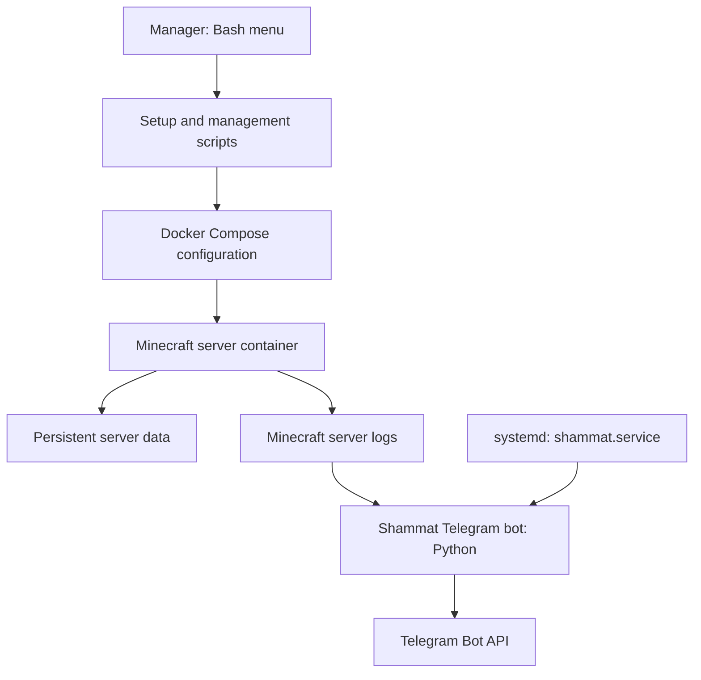
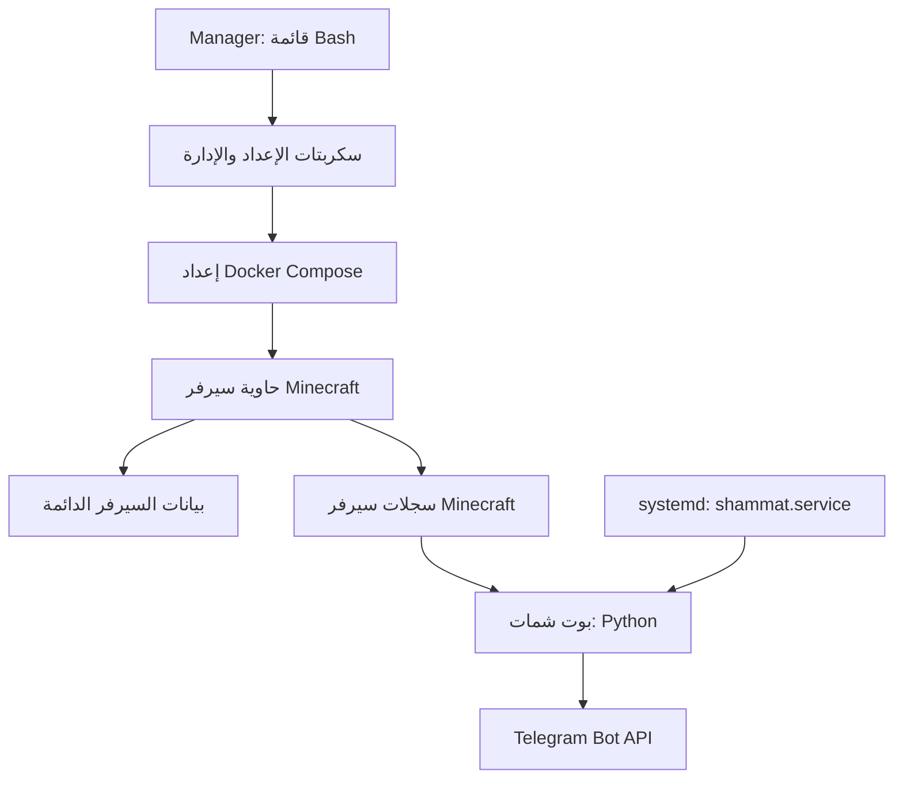

# Shammat | شمات

**One manager. One VPS. A Docker-powered Minecraft server and an optional Telegram companion bot.**

Shammat is a small server-management project designed to make setting up and managing a Minecraft server less intimidating. Instead of remembering a long list of commands, connect to your VPS, run a single installation command, then type `shammat` to open the interactive **Manager** and choose what you want to do.

**Languages:** [English](#english) · [العربية](#العربية)

- Install and manage a Minecraft server from a menu.
- Choose a Minecraft version and server type: Fabric, Forge, NeoForge, Paper, or Vanilla.
- Start, stop, restart, and inspect server logs.
- Create and restore server backups.
- Optionally install the Shammat Telegram bot.
- Use Arabic or English bot messages.

> **Important:** Shammat's Manager is a shell script intended for an Ubuntu-based Linux VPS and requires root privileges. It installs/configures software and writes files under `/root`. Review scripts before running them on a production server, and take backups before restoring or reconfiguring a server.

---

# English

## Why is it called “Shammat”?

**Shammat** (شمات) takes its name from the Arabic word **الشماتة** — gloating or teasing someone after a mishap. The project's original idea was a Minecraft companion that reacts when players die, with playful, sarcastic messages. The project also includes a Manager that helps you set up and control the Minecraft server itself.

## 1. What is the Manager?

The **Manager** is the control panel for the project. You run it in your VPS terminal and select actions from a simple numbered menu.

It can help you:

- Install a Minecraft server and choose its version and server type.
- Start, stop, restart, and view server logs.
- Open an interactive console to send Minecraft commands.
- Create backups and restore a previous backup.
- Install, restart, reconfigure, or remove the Shammat Telegram bot.
- Manage the Minecraft usernames allowed to request an in-game backup.

You do not need to run each management script manually: just type `shammat` and use its menu.

## 2. Before you start

You need:

- A Linux VPS running an Ubuntu-based distribution.
- SSH access and root privileges (or an account allowed to use `sudo`).
- Enough RAM and disk space for your chosen Minecraft version, players, mods, and world.
- Access to your VPS provider's firewall/security-group settings so you can allow the Minecraft port.
- `curl` and `git`. The installer is downloaded with `curl` and fetches the project with `git`; it does not install either of them for you. If one is missing, install both first:

```bash
sudo apt update
sudo apt install -y curl git
```

The included Docker setup script uses Docker's Ubuntu APT repository. Other distributions may require adapting that script.

### Do you need to be root?

Both the installer and the Manager require root privileges. You do not have to switch to a root shell: if your account has `sudo` permission, just put `sudo` in front of the commands below. (If you prefer a root shell, run `sudo -i` once; `whoami` should then print `root` and you can drop `sudo`.)

If `sudo` says you are not allowed to use it, you cannot grant yourself root access with a command. Sign in using the VPS provider's root account/console, or ask the server administrator to grant the required access. Do not share your root password or SSH private key.

## 3. Install Shammat with one command

Run this single command on your VPS:

```bash
sudo curl -sSL https://raw.githubusercontent.com/wissam-al-kahwaji/shammat/main/install.sh | sudo bash
```

The installer will:

1. Create `/root/shammat` and download the official Shammat repository (`https://github.com/wissam-al-kahwaji/shammat`) into it.
2. Make `manager.sh` executable.
3. Create a global `shammat` command at `/usr/local/bin/shammat`, so you can launch the Manager from any directory.

When it finishes it prints `Installation completed successfully!`. To confirm the command exists:

```bash
command -v shammat
```

It should print `/usr/local/bin/shammat`.

**The install location still matters.** Shammat's scripts expect the project at `/root/shammat`. You do not need to `cd` there yourself: the `shammat` command does that for you before starting the Manager.

> **Review before you run:** this command downloads a script from the internet and runs it as root. To read it first, open `https://raw.githubusercontent.com/wissam-al-kahwaji/shammat/main/install.sh` in your browser or run `curl -sSL https://raw.githubusercontent.com/wissam-al-kahwaji/shammat/main/install.sh`.

> **Already installed?** The installer removes the existing files inside `/root/shammat` before downloading a fresh copy. If that folder contains configuration, bot credentials, or backups, inspect it and back it up before running the command again.

## 4. Start the Manager

Once installation is complete, simply type:

```bash
shammat
```

If you are not logged in as root, use `sudo shammat`. You can run it from any directory; it is equivalent to running `cd /root/shammat && ./manager.sh`.

The Manager checks whether the Minecraft server and bot are installed, then displays its control menu. Type the number for the action you want. Type `exit` at the main menu to close the Manager.

## 5. Install your Minecraft server

From the Manager:

1. Choose **5 — Setup & Installation Center**.
2. Choose **1 — Install Minecraft Server**.
3. Enter the Minecraft version you want (for example, `1.21`). Press Enter to accept the displayed default.
4. Choose a server type:
   - **Fabric** — commonly used for Fabric mods.
   - **Forge** — commonly used for Forge mods.
   - **NeoForge** — another modded-server platform.
   - **Paper** — a performance-focused server that supports plugins.
   - **Vanilla** — the standard server without a mod/plugin platform.
5. Choose whether the server should use online-mode authentication. **Only choose offline/cracked mode if you understand the security risks.** Offline mode can allow impersonation of usernames unless access is otherwise protected.
6. Enter the server name/MOTD, world name, optional seed, and RAM allocation.
7. Let the setup finish. Shammat creates the Docker Compose configuration under `/root/minecraft` and starts the server container.

The server setup script currently fixes the server port at **8080**. Make sure TCP port `8080` is allowed in both the VPS provider firewall/security group and the operating-system firewall if enabled. Players will generally connect using `YOUR_VPS_IP:8080`. Do not assume the default Minecraft port `25565` is configured.

### Docker image and service architecture

Shammat does not build a custom Minecraft server image. The setup script generates a Docker Compose configuration that runs the upstream [`itzg/minecraft-server`](https://github.com/itzg/docker-minecraft-server) image.

The generated configuration is responsible for setting the selected Minecraft version and server type, mapping the game port, and mounting the server data directory. The container is expected to be named `minecraft-server`, which is also the name used by the Telegram bot integration.

Key details:

- **Container image:** `itzg/minecraft-server:latest` (as configured by the current setup script).
- **Container management:** Docker Compose.
- **Persistent data:** the host-side `./data` directory is mounted at `/data` inside the container.
- **Container name:** `minecraft-server`.
- **Configured game port:** TCP `8080` in the current setup script.
- **Restart policy:** `unless-stopped`.

> **Versioning note:** The `latest` image tag can change over time. For a more reproducible deployment, consider pinning a tested image version and documenting how to update it.

### Architecture overview



The Manager configures and controls the Minecraft server and optional Telegram bot. Minecraft runs in its own Docker container, while the Python bot is managed separately by `systemd` and reads the server logs to react to game events.

### Technology stack and external dependencies

| Component | Technology | Role |
|---|---|---|
| Management interface | Bash | Interactive setup and administration |
| Minecraft runtime | `itzg/minecraft-server` Docker image | Runs the selected Minecraft server distribution |
| Container orchestration | Docker Engine and Docker Compose | Creates and manages the Minecraft container |
| Telegram companion | Python | Processes game events and Telegram commands |
| Bot process management | systemd | Starts and supervises `shammat.service` |
| Game data | Host directory mounted at `/data` | Persists the world and server files outside the container |
| Messaging integration | Telegram Bot API | Delivers notifications and receives bot commands |

The Minecraft image is maintained by the upstream `itzg/docker-minecraft-server` project and is an external dependency of Shammat. Shammat provides the management scripts and configuration that connect these components; it does not claim to develop or maintain the Minecraft server software itself.

### Server controls

Open the Manager again and choose **1 — Server Status & Power Control**. Depending on the server state, the menu offers actions such as:

- Start or stop the server.
- Restart the server.
- View live or recent logs.

Choose **2 — Interactive In-Game Console** from the main menu to send Minecraft commands while the container is running. Type `exit` or `quit` to leave that console.

### Backups and restore

Choose **3 — Backup Manager & Restore** to create a manual backup or restore a previous one. A restore overwrites the current server data, so confirm that you selected the correct backup and keep a separate copy of anything important.

The backup script uses `7z`, stores backups under `/root/backups`, and is designed to upload backup parts to the configured Telegram chat. Review its timing and notification behavior before relying on it for production backups.

## 6. Install the Shammat Telegram bot (optional)

The bot is optional. You can run and manage the Minecraft server without installing it.

### What does the bot do?

Shammat reads the Minecraft server log and reacts to game events. Depending on the event and selected language, it can:

- Send playful death-related/gloating messages when players die.
- React to players joining or leaving and to advancements.
- Provide online-player, server-status, and death-count information.
- Send a roast/teasing message.
- Pass messages between the game and Telegram.
- Request, monitor, and cancel backups where permitted.
- Show the latest backup information.

The project includes Arabic and English text/response files. During setup, the Manager lets you install the bot and the setup script asks which language to use.

### Prepare Telegram

1. Create a Telegram bot using Telegram's official **@BotFather** and copy its bot token.
2. Determine the Telegram chat ID where Shammat should send messages. Add the bot to the intended chat if necessary and ensure it has permission to send messages.
3. Keep the token private. Anyone who obtains it may be able to control your bot.

### Install from the Manager

1. Run `shammat`.
2. Choose **4 — Shammat Telegram Bot Manager**, or **5 — Setup & Installation Center**.
3. Choose the option to install/configure the bot.
4. Select `ar` for Arabic or `en` for English when prompted.
5. Enter the Telegram bot token and chat ID when requested.
6. The setup script writes the configuration and installs/enables the `shammat.service` systemd service.

The bot expects the Minecraft container to be named `minecraft-server` and the server data at `/root/minecraft/data`, matching the included server setup.

### Bot controls and logs

Use **4 — Shammat Telegram Bot Manager** in the Manager to restart, reconfigure, or remove the bot service.

To inspect its service status and logs directly:

```bash
systemctl status shammat --no-pager
journalctl -u shammat -n 100 --no-pager
```

To follow logs live:

```bash
journalctl -u shammat -f
```

The bot configuration is stored in `/root/shammat/.telegram.env`. Do not publish or share this file; it contains credentials.

### Telegram commands

The bot supports these commands in its configured chat:

- `/start` or `/menu` — open the bot menu.
- `/online` — show online players.
- `/status` — show server status.
- `/deaths` — show the death leaderboard.
- `/roast` — request a teasing message.
- `/lastbackup` — show information about the latest backup.
- `/say message` — send a message to the Minecraft server.
- `/backup` — request a backup (admin-restricted).
- `/cancel` — cancel a pending backup where permitted.

In-game commands include `!help`, `!backup`, `!cancel`, `!tg message`, `!roast`, `!deaths`, and `!online`. Access to `!backup` can be managed from the Manager's **Manage In-Game Backup Admins** menu. Check the current configuration before relying on this as an access-control boundary.

## 7. Useful paths

| Path | Purpose |
|---|---|
| `/root/shammat` | Shammat source, scripts, language files, and bot configuration |
| `/root/shammat/.telegram.env` | Telegram credentials — keep private |
| `/root/minecraft` | Minecraft Docker Compose configuration and server data |
| `/root/backups` | Local server backup archives |
| `shammat.service` | systemd service for the Telegram bot |

## Troubleshooting

- **`Please run this script with root privileges`:** run the command with `sudo` (for example `sudo shammat`).
- **`shammat: command not found`:** the installer did not finish. Run the installation command again and read its output for errors (a missing `git` or `curl` is the most common cause).
- **`manager.sh` or a setup script is missing:** check that `/root/shammat` exists and contains the project files; if not, run the installation command again (back up any existing configuration first).
- **Server is not reachable:** check the container/logs, ensure TCP `8080` is allowed at the VPS provider firewall and OS firewall, and connect to `YOUR_VPS_IP:8080`.
- **Bot does not start:** check `systemctl status shammat` and `journalctl -u shammat -n 100 --no-pager`; verify the token/chat ID and the files under `/root/shammat`.
- **Bot does not see game events:** confirm the Minecraft container is running and named `minecraft-server`.

## Security notes

- Root scripts can change or delete system files. Read them before execution.
- Never commit `.telegram.env`, private tokens, passwords, SSH keys, or private player data.
- Restoring a backup replaces the current server directory.
- Offline/cracked Minecraft mode weakens normal account authentication.
- Keep the OS, Docker, and Minecraft server software updated.

## License

Shammat is licensed under the **MIT License**. You may use, copy, modify, merge, publish, distribute, sublicense, and sell copies of the software, subject to the license conditions. The MIT License does not prohibit selling Shammat or offering it as a paid service. See [`LICENSE`](LICENSE).

---

# العربية

## لماذا سُمّي المشروع «شمات»؟

اسم **شمات** مشتق من كلمة **الشماتة**؛ فالفكرة الأصلية كانت أن يتفاعل النظام مع موت اللاعبين في ماينكرافت برسائل ساخرة أو شماتية مرحة. ومع ذلك، فالمشروع ليس مجرد بوت؛ بل يتضمن أيضًا **Manager** لتثبيت سيرفر ماينكرافت وإدارته من قائمة واحدة، مع إمكانية إضافة البوت لاحقًا.

## 1. ما هو الـ Manager؟

الـ **Manager** هو لوحة تحكم تعمل داخل الطرفية على خادم VPS. بدلًا من حفظ مجموعة كبيرة من الأوامر، تشغّل المدير وتختار العملية التي تريدها من قائمة بسيطة.

يمكنه مساعدتك في:

- تثبيت سيرفر ماينكرافت واختيار الإصدار ونوع السيرفر.
- تشغيل السيرفر وإيقافه وإعادة تشغيله ومراجعة السجلات.
- إرسال أوامر ماينكرافت من واجهة الطرفية.
- إنشاء نسخ احتياطية واستعادة نسخة سابقة.
- تثبيت بوت شمات على تيليجرام وإعادة تشغيله أو إعادة ضبطه أو إزالة خدمته.
- إدارة أسماء اللاعبين المسموح لهم بطلب نسخة احتياطية من داخل اللعبة.

كل ما تحتاجه هو تنفيذ أمر تثبيت واحد، ثم كتابة `shammat` لتشغيل القائمة واتباعها.

## 2. ما الذي تحتاجه قبل البدء؟

- خادم VPS يعمل بتوزيعة مبنية على Ubuntu.
- اتصال SSH وصلاحيات root، أو حساب يستطيع استخدام `sudo`.
- ذاكرة RAM ومساحة تخزين مناسبتان لإصدار ماينكرافت وعدد اللاعبين والإضافات والعالم.
- إمكانية فتح المنفذ من لوحة مزود الـ VPS ومن جدار الحماية في النظام إن كان مفعّلًا.
- تثبيت `curl` و`git`. يُنزَّل المثبّت عبر `curl` ويجلب المشروع عبر `git`، ولا يقوم بتثبيت أيٍّ منهما نيابةً عنك. إذا كان أحدهما غير موجود فثبّتهما أولًا:

```bash
sudo apt update
sudo apt install -y curl git
```

سكريبت تثبيت Docker المرفق يستخدم مستودع Docker الخاص بـ Ubuntu؛ وقد يحتاج إلى تعديل إذا كنت تستخدم توزيعة أخرى.

### هل تحتاج إلى صلاحيات root؟

المثبّت والـ Manager كلاهما يتطلبان صلاحيات root. لا حاجة للانتقال إلى جلسة root؛ إذا كان حسابك يمتلك صلاحية `sudo` فيكفي وضع `sudo` قبل الأوامر الموضحة أدناه. (وإن فضّلت جلسة root، نفّذ `sudo -i` مرة واحدة؛ ثم يظهر `root` عند تنفيذ `whoami` ويمكنك حينها حذف `sudo`.)

إذا ظهرت رسالة تفيد بأن حسابك غير مخوّل لاستخدام `sudo`، فلا يمكنك منح نفسك صلاحية root بأمر عادي. استخدم حساب root الذي وفره مزود الخادم أو اطلب من مدير الخادم منحك الصلاحية. لا تشارك كلمة مرور root أو المفتاح الخاص لاتصال SSH.

## 3. تثبيت شمات بأمر واحد

نفّذ الأمر التالي على خادم الـ VPS:

```bash
sudo curl -sSL https://raw.githubusercontent.com/wissam-al-kahwaji/shammat/main/install.sh | sudo bash
```

يقوم المثبّت بما يلي:

1. إنشاء المجلد `/root/shammat` وتنزيل مستودع شمات الرسمي (`https://github.com/wissam-al-kahwaji/shammat`) إليه.
2. جعل `manager.sh` قابلًا للتنفيذ.
3. إنشاء الأمر العام `shammat` في المسار `/usr/local/bin/shammat`، ليمكنك تشغيل المدير من أي مجلد.

عند الانتهاء تظهر الرسالة `Installation completed successfully!`. وللتأكد من وجود الأمر:

```bash
command -v shammat
```

يجب أن تكون النتيجة `/usr/local/bin/shammat`.

**مسار التثبيت ما زال مهمًا:** تعتمد سكربتات شمات على وجود المشروع داخل `/root/shammat`. لا تحتاج إلى الانتقال إليه بنفسك، فالأمر `shammat` ينتقل إليه تلقائيًا قبل تشغيل المدير.

> **راجع السكربت قبل تشغيله:** هذا الأمر يُنزّل سكربتًا من الإنترنت وينفّذه بصلاحيات root. لقراءته أولًا افتح الرابط `https://raw.githubusercontent.com/wissam-al-kahwaji/shammat/main/install.sh` في المتصفح أو نفّذ `curl -sSL https://raw.githubusercontent.com/wissam-al-kahwaji/shammat/main/install.sh`.

> **هل شمات مثبّت مسبقًا؟** يحذف المثبّت الملفات الموجودة داخل `/root/shammat` قبل تنزيل نسخة جديدة. إذا كان المجلد يحتوي على إعدادات أو بيانات البوت أو نسخ مهمة، فافحصه وخذ نسخة احتياطية قبل إعادة تنفيذ الأمر.

## 4. تشغيل الـ Manager

بعد اكتمال التثبيت يكفي أن تكتب:

```bash
shammat
```

وإذا لم تكن مسجّلًا بصفة root فاكتب `sudo shammat`. يمكنك تنفيذه من أي مجلد، وهو مكافئ لتنفيذ `cd /root/shammat && ./manager.sh`.

ستظهر قائمة التحكم وحالة تثبيت السيرفر والبوت. اكتب رقم الخيار المطلوب واتبع التعليمات التي تظهر على الشاشة. للخروج، اكتب `exit` في القائمة الرئيسية.

## 5. تثبيت سيرفر ماينكرافت

من القائمة الرئيسية:

1. اختر **5 — Setup & Installation Center**، أي مركز التثبيت والإعداد.
2. اختر **1 — Install Minecraft Server**.
3. أدخل إصدار ماينكرافت المطلوب، مثل `1.21`، أو اضغط Enter لقبول القيمة الافتراضية الظاهرة.
4. اختر نوع السيرفر:
   - **Fabric:** شائع لتشغيل مودات Fabric.
   - **Forge:** لتشغيل مودات Forge.
   - **NeoForge:** منصة أخرى للسيرفرات المعدّلة.
   - **Paper:** سيرفر يركز على الأداء ويدعم الإضافات Plugins.
   - **Vanilla:** السيرفر القياسي دون منصة مودات أو إضافات.
5. حدّد ما إذا كنت تريد التحقق المعتاد من حسابات اللاعبين. **لا تفعّل وضع offline/cracked إلا إذا كنت تفهم مخاطره الأمنية**؛ فقد يسمح بانتحال أسماء اللاعبين ما لم تُضف حماية أخرى.
6. أدخل اسم السيرفر الذي يظهر للاعبين، واسم العالم، والبذرة الاختيارية، وحجم RAM.
7. انتظر حتى ينتهي الإعداد. سينشئ المشروع إعداد Docker داخل `/root/minecraft` ثم يبدأ تشغيل السيرفر.

### المنفذ الذي يستخدمه السيرفر

إعداد السيرفر الحالي يثبت المنفذ على **8080**. افتح TCP 8080 من لوحة تحكم مزود الـ VPS ومن جدار الحماية في النظام إن كان مستخدمًا. يتصل اللاعبون عادةً باستخدام:

```text
IP-ADDRESS:8080
```

لا تفترض أن المنفذ الافتراضي `25565` مستخدم؛ فالسكريبت الحالي مضبوط على `8080`.

### صورة Docker ومعمارية الخدمات

لا يقوم مشروع شمات ببناء صورة Minecraft مخصصة من الصفر. بل ينشئ سكربت الإعداد ملف Docker Compose لتشغيل الصورة الجاهزة [`itzg/minecraft-server`](https://github.com/itzg/docker-minecraft-server)، التي تتم صيانتها في مشروع مستقل.

يتولى الإعداد إنشاء الحاوية وضبط إصدار ماينكرافت ونوع السيرفر والمنفذ، مع ربط مجلد بيانات السيرفر داخل الحاوية. ويُستخدم الاسم `minecraft-server` للحاوية في إعدادات المشروع، وكذلك في تكامل بوت تيليجرام.

التفاصيل الأساسية في إعداد المشروع الحالي:

- **صورة Docker:** `itzg/minecraft-server:latest`.
- **إدارة الحاوية:** Docker Compose.
- **حفظ البيانات:** يُربط المجلد المحلي `./data` بالمسار `/data` داخل الحاوية.
- **اسم الحاوية:** `minecraft-server`.
- **منفذ اللعبة المضبوط:** TCP `8080`.
- **سياسة إعادة التشغيل:** `unless-stopped`.

> **ملاحظة حول الإصدارات:** قد تتغير الصورة المشار إليها بالوسم `latest` بمرور الوقت. للحصول على نشر أكثر قابلية للتكرار، يُفضّل تثبيت وسم إصدار محدد بعد اختباره، مع توثيق طريقة تحديثه.

### نظرة عامة على المعمارية



يتولى الـ Manager إعداد سيرفر ماينكرافت والتحكم به وإدارة البوت الاختياري. يعمل السيرفر داخل حاوية Docker مستقلة، بينما يعمل بوت Python كخدمة منفصلة يديرها `systemd`، ويقرأ سجلات السيرفر للتفاعل مع أحداث اللعبة.

### التقنيات والاعتماديات الخارجية

| المكوّن | التقنية | الاستخدام |
|---|---|---|
| واجهة الإدارة | Bash | الإعداد والإدارة من خلال قائمة تفاعلية |
| تشغيل Minecraft | صورة Docker المسماة `itzg/minecraft-server` | تشغيل نوع السيرفر وإصداره المحددين |
| إدارة الحاويات | Docker Engine وDocker Compose | إنشاء حاوية Minecraft وإدارتها |
| بوت تيليجرام | Python | معالجة أحداث اللعبة وأوامر تيليجرام |
| إدارة عملية البوت | systemd | تشغيل ومراقبة الخدمة `shammat.service` |
| بيانات اللعبة | مجلد محلي مربوط بالمسار `/data` | حفظ العالم وملفات السيرفر خارج الحاوية |
| التكامل مع الرسائل | Telegram Bot API | إرسال الإشعارات واستقبال أوامر البوت |

تتم صيانة صورة Minecraft من قبل مشروع `itzg/docker-minecraft-server` المستقل، وهي اعتماد خارجي يستخدمه شمات. أما شمات فيوفّر سكربتات الإدارة والإعداد التي تربط هذه المكونات معًا؛ ولا يدّعي المشروع تطوير برنامج سيرفر Minecraft نفسه أو صيانته.

### التحكم بالسيرفر

شغّل المدير مجددًا واختر **1 — Server Status & Power Control** للتحكم بالتشغيل والإيقاف وإعادة التشغيل ومراجعة السجلات.

ومن القائمة الرئيسية اختر **2 — Interactive In-Game Console** لإرسال أوامر ماينكرافت طالما أن السيرفر يعمل. اكتب `exit` أو `quit` للخروج من واجهة الأوامر.

### النسخ الاحتياطي والاستعادة

اختر **3 — Backup Manager & Restore** لإنشاء نسخة احتياطية أو استعادة نسخة سابقة. انتبه: الاستعادة تستبدل بيانات السيرفر الحالية، لذا تأكد من اختيار النسخة الصحيحة واحتفظ بنسخة مستقلة من ملفاتك المهمة.

يستخدم سكربت النسخ الاحتياطي أداة `7z` ويحفظ الأرشيفات محليًا في `/root/backups`، كما أنه مصمم لإرسال أجزاء النسخة إلى محادثة تيليجرام المضبوطة. راجع إعدادات النسخ وتوقيته قبل الاعتماد عليه في سيرفر إنتاجي.

## 6. تثبيت بوت شمات على تيليجرام (اختياري)

يمكنك استخدام الـ Manager لتثبيت سيرفر ماينكرافت وإدارته دون تثبيت البوت. البوت إضافة اختيارية.

### ماذا يفعل البوت؟

يراقب شمات سجلات سيرفر ماينكرافت ويتفاعل مع أحداث اللعبة. ومن وظائفه:

- إرسال رسائل شماتة أو سخرية مرحة عندما يموت اللاعب.
- التفاعل مع دخول اللاعبين وخروجهم وإنجازاتهم داخل اللعبة.
- عرض اللاعبين المتصلين وحالة السيرفر وإحصائية أكثر اللاعبين موتًا.
- إرسال رسالة ساخرة للاعب.
- تمرير رسائل بين اللعبة وتيليجرام.
- طلب النسخ الاحتياطية ومتابعتها وإلغاؤها وفق الصلاحيات.
- عرض معلومات آخر نسخة احتياطية.

يتضمن المشروع ملفات رسائل عربية وإنجليزية. أثناء إعداد البوت يمكنك اختيار اللغة التي تريد استخدامها.

### تجهيز تيليجرام

1. أنشئ بوتًا عبر **@BotFather** الرسمي في تيليجرام وانسخ رمز البوت (Bot Token).
2. جهّز **Chat ID** للمحادثة التي تريد استقبال الرسائل فيها، وأضف البوت إلى المجموعة إذا لزم الأمر، مع منحه صلاحية إرسال الرسائل.
3. احتفظ بالرمز بسرية؛ فكل من يحصل عليه قد يتمكن من التحكم بالبوت.

### تثبيت البوت من خلال Manager

1. شغّل الأمر `shammat`.
2. اختر **4 — Shammat Telegram Bot Manager** أو **5 — Setup & Installation Center**.
3. اختر تثبيت البوت وإعداده.
4. اختر `ar` للعربية أو `en` للإنجليزية عندما يُطلب منك ذلك.
5. أدخل Bot Token وChat ID.
6. سيحفظ سكربت الإعداد الإعدادات وينشئ خدمة النظام `shammat.service` ثم يفعّلها ويشغّلها.

يتوقع البوت أن يكون اسم حاوية ماينكرافت `minecraft-server` وأن تكون بيانات السيرفر في `/root/minecraft/data`، كما ينشئ إعداد السيرفر المرفق.

### إدارة البوت ومراجعة السجلات

من قائمة **4 — Shammat Telegram Bot Manager** يمكنك إعادة تشغيل خدمة البوت أو إعادة إعداد بيانات تيليجرام أو إزالة الخدمة.

ولمعرفة حالة الخدمة والسجلات مباشرةً:

```bash
systemctl status shammat --no-pager
journalctl -u shammat -n 100 --no-pager
```

لمتابعة السجلات مباشرة:

```bash
journalctl -u shammat -f
```

تُحفظ إعدادات تيليجرام في:

```text
/root/shammat/.telegram.env
```

هذا الملف يحتوي على بيانات سرية؛ لا تنشره ولا ترفعه إلى Git.

### أوامر البوت في تيليجرام

يدعم البوت الأوامر التالية داخل المحادثة المضبوطة:

- `/start` أو `/menu` — عرض قائمة البوت.
- `/online` — عرض اللاعبين المتصلين.
- `/status` — عرض حالة السيرفر.
- `/deaths` — عرض ترتيب اللاعبين حسب عدد مرات الموت.
- `/roast` — طلب رسالة ساخرة.
- `/lastbackup` — معلومات آخر نسخة احتياطية.
- `/say message` — إرسال رسالة إلى سيرفر ماينكرافت.
- `/backup` — طلب نسخة احتياطية، وهو أمر مقيّد بصلاحيات الإدارة.
- `/cancel` — إلغاء نسخة احتياطية معلّقة حيثما كان ذلك مسموحًا.

ومن داخل اللعبة تتوفر أوامر مثل `!help` و`!backup` و`!cancel` و`!tg message` و`!roast` و`!deaths` و`!online`. يمكن إدارة أسماء اللاعبين المسموح لهم بطلب النسخ الاحتياطية من خيار **Manage In-Game Backup Admins** في المدير. راجع الإعدادات الحالية قبل الاعتماد عليها كحدّ أمني للصلاحيات.

## 7. مسارات مهمة

| المسار | الاستخدام |
|---|---|
| `/root/shammat` | ملفات شمات والسكربتات واللغات وإعدادات البوت |
| `/root/shammat/.telegram.env` | بيانات تيليجرام السرية |
| `/root/minecraft` | إعداد Docker وبيانات سيرفر ماينكرافت |
| `/root/backups` | النسخ الاحتياطية المحلية |
| `shammat.service` | خدمة systemd الخاصة ببوت تيليجرام |

## حل المشكلات الشائعة

- **ظهور رسالة `Please run this script with root privileges`:** شغّل الأمر باستخدام `sudo`، مثل `sudo shammat`.
- **ظهور `shammat: command not found`:** لم يكتمل التثبيت. أعد تنفيذ أمر التثبيت وراجع مخرجاته بحثًا عن أخطاء (أكثر الأسباب شيوعًا غياب `git` أو `curl`).
- **عدم العثور على `manager.sh` أو أحد السكربتات:** تأكد من وجود `/root/shammat` وأنه يحتوي على ملفات المشروع؛ وإن لم يكن كذلك فأعد تنفيذ أمر التثبيت (بعد أخذ نسخة احتياطية من أي إعدادات موجودة).
- **عدم إمكانية الاتصال بالسيرفر:** افحص سجلات الحاوية، وافتح TCP 8080 في جدار الحماية لدى مزود الـ VPS وفي النظام، ثم اتصل عبر `IP-ADDRESS:8080`.
- **عدم تشغيل البوت:** راجع `systemctl status shammat` و`journalctl -u shammat -n 100 --no-pager` وتحقق من رمز البوت وChat ID والملفات الموجودة داخل `/root/shammat`.
- **عدم تفاعل البوت مع أحداث اللعبة:** تأكد من تشغيل حاوية ماينكرافت وأن اسمها `minecraft-server`.

## ملاحظات أمنية

- تعمل السكربتات بصلاحيات root ويمكنها تعديل ملفات النظام أو حذفها؛ راجعها قبل التنفيذ.
- لا ترفع `.telegram.env` أو الرموز السرية أو كلمات المرور أو مفاتيح SSH أو بيانات اللاعبين الخاصة إلى المستودع.
- استعادة النسخ الاحتياطية تستبدل بيانات السيرفر الحالية.
- وضع offline/cracked يضعف التحقق المعتاد من هوية حسابات ماينكرافت.
- حدّث النظام وDocker وبرمجيات السيرفر باستمرار.

## الترخيص

يستخدم شمات ترخيص **MIT**. يسمح هذا الترخيص بالاستخدام والنسخ والتعديل والنشر والتوزيع، كما يسمح ببيع نسخ من البرنامج أو تقديمه كخدمة مدفوعة، مع الالتزام بشروط الترخيص وإبقاء إشعار حقوق النشر ونص الترخيص. راجع ملف [`LICENSE`](LICENSE).

---

*Shammat — شمات: بدأ من الشماتة عند موت اللاعب، وأصبح مديرًا بسيطًا لسيرفر ماينكرافت وبوتًا اختياريًا.*
